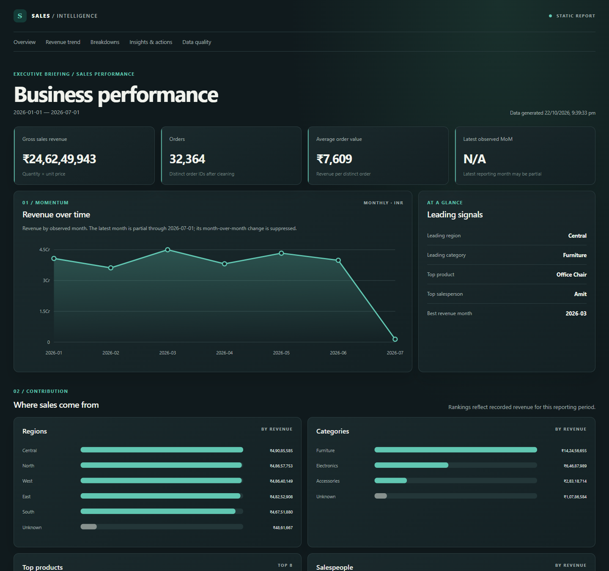

# Automated Sales Reporting Pipeline

Turn monthly sales CSV exports into a cleaned, auditable analysis and a portable executive dashboard. The pipeline validates and prepares transaction records, calculates sales KPIs and time trends, generates evidence-based observations, and writes a standalone HTML report with locally generated charts.



## What it does

- Reads and combines CSV files from `data/raw/` in deterministic filename order.
- Normalizes text, dates, and numeric fields; fills selected missing dimensions as `Unknown`; drops invalid required records and duplicate order IDs.
- Calculates revenue, order count, units, average order value, monthly revenue, and month-over-month revenue change.
- Breaks performance down by region, category, product, and salesperson.
- Generates rule-based findings and investigation recommendations. Recommendations are prompts for review, not causal explanations.
- Produces local PNG charts and a responsive HTML dashboard that works without a network connection.
- Shows basic cleaning impact in the report: source/retained/excluded rows, duplicate orders removed, and filled dimension values.

## Dashboard

The dashboard includes an executive KPI row, monthly revenue trend, performance highlights, regional/category/product/salesperson charts, generated actions, and data preparation metrics. Month-over-month change is omitted when there is no valid previous-month denominator; the report states when comparison is unavailable.

Current screenshot files:

- [Overview](docs/images/dashboard-preview.png)
- [Full dashboard capture](docs/images/dashboard-full.png)

## Technology

- Python 3.13 or newer (per `pyproject.toml`)
- pandas, NumPy, Matplotlib
- pytest and Ruff for development
- No JavaScript or remote assets are required to view the report.

## Architecture and data flow

```text
data/raw/*.csv
  → src/ingestion (read CSVs)
  → src/cleaning (normalize, fill permitted dimensions, exclude invalid rows, deduplicate)
  → src/analytics (revenue, KPI, monthly and dimension aggregations, insights)
  → src/reporting (recommendations, chart PNGs, HTML)
  → reports/business-performance-report.html
```

Main repository layout:

```text
data/raw/                 Example monthly source CSVs
data/metadata/            Data generation/quality metadata
docs/images/              Dashboard screenshots
reports/                  Generated HTML report and chart PNGs
src/ingestion/             CSV loading and validation
src/cleaning/              Text, date, numeric, missing-value and duplicate handling
src/analytics/             KPI, aggregation, time-series and insight logic
src/reporting/             Report model, builder, charts, HTML and recommendations
tests/                     Pipeline and component tests
run.py                     Project-root command-line entry point
pyproject.toml             Package, dependency and tool configuration
```

## Setup

Use Python 3.13 or newer. From the repository root:

```powershell
python -m venv .venv
.venv\Scripts\Activate.ps1
python -m pip install -e ".[dev]"
```

On macOS/Linux, activate with `source .venv/bin/activate`.

## Input data

Place one or more CSV files in `data/raw/`. Each file must contain these columns:

`Order_ID`, `Order_Date`, `Customer_ID`, `Product`, `Category`, `Region`, `Salesperson`, `Quantity`, `Unit_Price`.

Dates must be parseable by pandas and quantity/price must be numeric and positive to remain in the cleaned dataset. Missing `Customer_ID`, `Region`, or `Salesperson` values are kept as `Unknown`; missing core fields and invalid non-positive quantities/prices are excluded. Duplicate removal uses `Order_ID` and keeps the first row in sorted file/read order. Back up source files before replacing them; the pipeline reads but does not modify them.

## Generate the report

From the project root, run:

```powershell
python run.py
```

This refreshes `reports/charts/*.png` and `reports/business-performance-report.html` from the current CSV files. Open the HTML report directly in a browser; chart links are relative to the report directory. The module entry point is also available as `python -m src.reporting.run`.

## Tests and code quality

```powershell
python -m pytest
python -m ruff check .
python -m ruff format --check .
```

## KPI definitions and assumptions

- **Revenue:** `Quantity × Unit_Price` summed across retained rows. The source has no discount, tax, refund, or cost fields, so revenue is not profit or net revenue.
- **Orders:** distinct `Order_ID` count. Duplicate IDs are removed before analytics.
- **Units:** sum of retained `Quantity` values.
- **Average order value:** total revenue divided by distinct orders; zero when there are no orders.
- **Monthly revenue:** revenue grouped by calendar month. Months with no transactions are not synthesized as zero-sales months.
- **MoM growth:** `(current month revenue / prior observed month revenue − 1) × 100`. A zero prior value or a missing prior month makes the rate unavailable. Because empty months are not added, this is the prior observed month, which may not be the immediately preceding calendar month.
- **Rankings and findings:** describe the supplied reporting period only; they do not establish why performance changed.

## Data quality and limitations

Input columns are validated in the schema module; the cleaning pipeline applies normalization and exclusion rules before analytics. The dashboard reports cleaning totals but does not yet expose per-column invalid record counts or a complete before/after validation table. The demo pipeline has no configurable currency, profit/cost measures, customer cohort analysis, or causal attribution. Treat automated insights and recommendations as review prompts and confirm source completeness, especially for partial months.

## Potential next steps

- Add configurable currency and date/reporting-period options.
- Add an explicit validation summary with per-rule record counts and source-file traceability.
- Support zero-activity calendar months and user-selected comparison windows.
- Add profit metrics when cost data is available.
- Add interactive filtering only if it can remain self-contained and accessible offline.

## License

MIT. See the repository license file if present.
