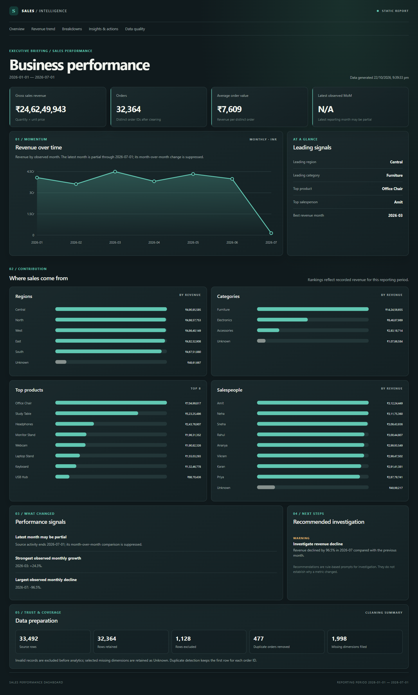

# Automated Sales Reporting Pipeline

A portfolio-ready sales analytics project with a static executive dashboard designed for GitHub Pages. Visitors open the website directly; they do not need Python, a local server, or `run.py`.

**Dashboard:** [Open the GitHub Pages project site](https://ashishsrs01.github.io/Automated-sales-reporting-pipeline/) *(available after the first successful Pages deployment; deployment has not been run from this workspace).*




## What the dashboard shows

- Executive sales revenue, distinct order count, average order value, and month-over-month change when a valid complete-period comparison is available.
- Observed monthly revenue, plus regional, category, product, and salesperson rankings.
- Data-backed performance findings and rule-based investigation recommendations.
- Data preparation counts for source rows, retained rows, exclusions, removed duplicate orders, and filled missing dimensions.
- Responsive layout, semantic sections, and no external libraries, fonts, or CDN requests.

The current demo dataset is the set of monthly CSV files committed under `data/raw/`. The dashboard is generated from those files; its metrics are not sample placeholders. The source data ends on 2026-07-01, so the latest month may be partial and its month-over-month comparison is suppressed.

## Architecture

```text
data/raw/*.csv
  → Python ingestion, cleaning and analytics
  → report model with KPIs, breakdowns, findings and cleaning totals
  → site/assets/data/dashboard.json
  → static site/index.html + assets/css + assets/js
  → GitHub Pages project site
```

`run.py` is an optional build command for maintainers and CI. It refreshes the local Python report and chart outputs as before, and also rebuilds the JSON consumed by the static website. The public website is HTML, CSS, JavaScript and JSON; it does not execute Python in a visitor's browser.

All website references are relative (`assets/...`), so they resolve correctly when GitHub Pages serves the repository beneath `/Automated-sales-reporting-pipeline/`.

## Repository map

```text
data/raw/                    Source sales CSV files
data/metadata/               Dataset quality metadata
docs/images/                 Genuine dashboard screenshots
reports/                     Optional Python HTML report and Matplotlib charts
site/index.html              GitHub Pages entry point
site/assets/css/             Responsive dashboard styles
site/assets/js/              Static dashboard rendering
site/assets/data/            Generated dashboard JSON
src/ingestion/               CSV loading and validation
src/cleaning/                Text/date/numeric normalization and record handling
src/analytics/               KPIs, aggregations, time series and insights
src/reporting/               Report models, HTML, charts and static JSON export
tests/                       Analytics, reporting and static export tests
.github/workflows/pages.yml  GitHub Actions Pages build and deployment
run.py                       Optional analytics and dashboard-data build command
pyproject.toml               Python dependencies and tool configuration
```

## Maintainer setup

Python is only needed to regenerate the dashboard data or run development checks. Python 3.13 or newer is declared by this project.

```powershell
python -m venv .venv
.venv\Scripts\Activate.ps1
python -m pip install -e ".[dev]"
python run.py
```

On macOS/Linux, activate the environment with `source .venv/bin/activate`. To preview `site/` locally, run `python -m http.server 8000 --directory site` and open `http://localhost:8000/`. This local preview is a maintainer convenience; it is not required by website visitors.

If you provide another dataset, place CSV files in `data/raw/` with these columns:

`Order_ID`, `Order_Date`, `Customer_ID`, `Product`, `Category`, `Region`, `Salesperson`, `Quantity`, `Unit_Price`.

After changing the input data, run `python run.py` to refresh the committed JSON data and optional report outputs.

## Tests and quality checks

```powershell
python -m pytest
python -m ruff check .
python -m ruff format --check .
```

GitHub Actions runs these checks, regenerates the JSON from `data/raw/`, then deploys the `site/` directory.

## Enable and deploy GitHub Pages

There was no Pages workflow or static site configuration in the repository before this change. The new `.github/workflows/pages.yml` deploys on pushes to `main` and on manual workflow dispatch.

For the initial deployment, open **GitHub → repository Settings → Pages**, set the build and deployment source to **GitHub Actions**, then run the **Build and deploy dashboard** workflow (or push a later change to `main`). GitHub Actions needs repository permission to deploy Pages. The expected project URL is `https://ashishsrs01.github.io/Automated-sales-reporting-pipeline/`; it should be considered live only after the workflow completes successfully and GitHub Pages reports the deployed site.

The initial deployment requires Pages to be enabled for this repository as described above. Verify the Actions run and public URL after enabling Pages and triggering the workflow.

## Metric definitions and limits

- **Sales revenue:** sum of `Quantity × Unit_Price`. The dataset has no cost, refund, tax or discount fields, so revenue does not mean profit or net revenue.
- **Orders:** number of distinct `Order_ID` values after duplicate removal.
- **Average order value:** total sales revenue divided by distinct orders.
- **Month-over-month change:** current observed month divided by previous observed month, minus one. A zero prior denominator is unavailable. The dashboard also suppresses this comparison when the last transaction date shows that the latest calendar month is partial.
- **Missing dimensions:** missing customer, region or salesperson values are retained as `Unknown`; invalid required rows are excluded. Duplicate order handling keeps the first row.
- **Interpretation:** insights describe observed values; recommendations are heuristic investigation prompts and do not establish cause.

The pipeline does not synthesize months with no transactions, quantify profit, support configurable currencies, or prove that a data cutoff reflects full source-system coverage. Review the input reporting period before using the numbers for operational decisions.

## License

MIT. See the repository license file if present.
